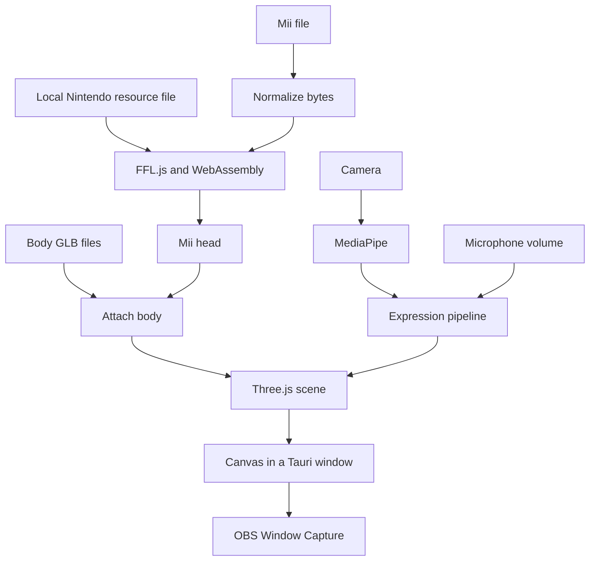

# MiiTuber creator guide

This guide explains app version `0.2.2` in the current working tree. It uses the source code and a local test of the supplied `unc gavin.ffsd` file. Capture uses the main MiiTuber window.

Read sections 1 to 8 first. They explain the main system. Use sections 9 to 17 when you make a change. Sections 18 and 19 give you practice tasks and questions.

## 1. What your app does

MiiTuber turns Mii appearance data into an animated 3D avatar. Four main systems do this:

1. **The interface** lets the user import a Mii, select devices, and change settings.
2. **The Mii renderer** builds the Mii head and attaches it to a body.
3. **The tracking system** converts camera and microphone input into an expression and head rotation.
4. **The desktop shell** supplies native windows, file access, and app updates.

The main application code is TypeScript. It runs in a webview: a browser surface inside a desktop window. The Rust code starts that desktop environment. Rust does not process each camera frame or draw the Mii.

There is no React, application server, account system, or database server in this repository. The interface uses HTML, CSS, and direct JavaScript changes to page elements.



Keep **appearance** and **pose** separate in your thinking. The Mii file defines appearance. Live input changes the pose of the model that already exists. The app does not rebuild a Mii from the camera on each frame.

## 2. The tools and files you own

| Tool or file | Its job |
| --- | --- |
| [index.html](index.html) | The page structure, buttons, inputs, menus, dialogs, and canvas |
| [src/styles.css](src/styles.css) | Layout, colors, visibility, dialogs, and capture modes |
| [src/main.ts](src/main.ts) | Connects the interface, stored data, tracking, renderer, and native APIs |
| TypeScript | Adds type checks to JavaScript; the browser runs the built JavaScript |
| Vite | Serves source files during development and builds web assets into `dist/` |
| Three.js | Owns the scene, camera, lights, GPU renderer, meshes, and orbit controls |
| FFL.js | Reads Mii data and makes Mii geometry and expression textures |
| WebAssembly, or WASM | Runs the compiled FFL code inside the webview |
| MediaPipe | Runs a face model and returns face scores and a transformation matrix |
| Web Audio | Reads microphone samples for mouth activation |
| Tauri | Connects the web interface to the desktop operating system |
| Rust and Cargo | Build and configure the native part of Tauri |
| Vitest | Runs the TypeScript unit tests |
| [package-lock.json](package-lock.json) | Records exact installed JavaScript dependency versions |
| [src-tauri/Cargo.lock](src-tauri/Cargo.lock) | Records exact Rust dependency versions |

Your main design decisions are in the modules under `src/lib/` and in `main.ts`. Much of the difficult Mii format and rendering work comes from FFL.js. You still need to understand how your code prepares its inputs, owns its objects, and handles failures.

Do not edit generated `dist/` files or installed `node_modules/` files to make a permanent app change. Change source or dependency configuration, then build again.

## 3. What happens at startup

Start in [index.html](index.html). It loads `src/styles.css` and the module `src/main.ts`.

`main.ts` finds page elements with calls such as:

```ts
document.querySelector<HTMLCanvasElement>("#mii-viewer")
```

`#mii-viewer` means the element with that ID. The TypeScript type tells the compiler which element methods to expect. It does not prove that the element exists. The canvas has an explicit check. Many other elements use optional access, such as `button?.addEventListener(...)`, which does nothing when the element is missing.

The module creates one `AvatarScene`, one `FaceTracker`, one `ExpressionPipeline`, and one `AvatarPoseCoordinator`. It then calls `initializeMainWindow()`.

The main window loads the tuning profile, builds controls, applies preferences, and shows the library. It also starts device enumeration, an update check, and FFL initialization. The tour waits for the resource setup and update interface to finish.

The app starts in the library. Stored avatar data does not mean that an avatar model is already loaded into the scene.

### How to read the code patterns

- **`import` / `export`:** These connect modules. Follow imports to find who owns a function.
- **`type` / `interface`:** These describe data for the compiler. They do not validate a file at runtime.
- **`class`:** This groups state and methods. A filter instance remembers its previous sample.
- **`async` / `await`:** A function can wait for a file, model, or native API. Other events can run while it waits.
- **`Promise`:** This represents work that will finish later. A cached promise lets several callers wait for the same initialization.
- **`addEventListener`:** This connects user or browser events to behavior.
- **`requestAnimationFrame`:** This asks the browser to run a function before a future display frame. It does not guarantee a specific frame rate.
- **`void someAsyncFunction()`:** This starts work without waiting for its result here. It does not catch a rejected promise.
- **`textContent`:** This inserts text without parsing it as HTML. The library uses it for avatar names.

Top-level statements in a module run during module evaluation. Function declarations are available before their textual position, but `let` and `const` values are not usable before initialization. Keep startup state declarations before the initialization call that uses them.

## 4. Your actual Mii file, from import to screen

The supplied file is **96 bytes**. In the local test, FFL read these values:

| Field | Value |
| --- | --- |
| Name | `unc gavin`, followed by null padding in the decoded field |
| Gender field | `0`, which this app uses to select `male.glb` |
| Height field | `64` |
| Build field | `64` |
| Favorite color index | `11` |

Height and build are Mii format values. They are not physical measurements. The resource file supplies the shapes and textures. Your small FFSD file supplies parameters that select and position those parts. It does not contain a complete 3D mesh or camera footage.

Here is the actual import path:

```text
Add Avatar
  -> openImportModal()
  -> file input change
  -> handleImportFile()
  -> file.arrayBuffer()
  -> normalizeMiiBytes()
  -> renderMiiThumbnail()
  -> getFflContext()
  -> renderMiiThumbnailDataUrl()
  -> pendingImport
  -> Save Avatar
  -> saveImportedAvatar()
  -> addAvatar()
  -> localStorage
```

`ArrayBuffer` is a block of bytes. `Uint8Array` lets the code access each byte as a number from 0 to 255. `Array.from(miiBytes)` creates a normal number array so JSON can store it.

The thumbnail step is also an import check. If FFL cannot render the file, the app does not save the avatar. A file with the expected extension and length can still contain invalid data.

The import name comes from the **filename** with its extension removed. It does not come from the internal Mii name. These names happened to match for your file. Rename Avatar changes library metadata; it does not rewrite the Mii bytes.

After saving, the user selects the library tile:

```text
selectAvatar(id)
  -> getAvatar()
  -> switch interface to workspace
  -> renderAvatarBytes()
  -> getFflContext()
  -> AvatarScene.loadModelFromMiiBytes()
  -> createCharModel()
  -> attachBodyToCharModel()
  -> frame the model
  -> apply a neutral expression and head rotation
```

Your file passed the thumbnail path and the workspace path. All expression indices from `0` through `18` were accepted by FFL. The browser interface also processed selection changes for those 19 expressions.

### Format handling

[miiData.ts](src/lib/miiData.ts) normalizes data mostly by byte length:

| Length | Current handling |
| --- | --- |
| 46 / 47 | Pass through as Mii Studio data |
| 74 / 76 | Pass through as Wii Mii data |
| 96 | Pass through as FFSD/CFSD data |
| 104 / 106 / 108 | Keep the first 96 bytes, under the legacy MIIC format assumption |
| 128 | Reject with an unsupported modern MIIC error |
| Other | Pass through and let the installed FFL.js decoder decide |

The installed FFL.js also has paths for 88-byte Switch `CharInfo` and 288-byte internal FFL `CharInfo`. These pass through your normalizer. This does not mean all Switch Mii formats work. The dependency rejects some other lengths.

Renaming a `.miic` file to `.ffsd` does not convert it. Format support requires a correct decoder and data conversion. Adding an extension to the file picker is only an interface change.

The current HTML file filter lists `.ffsd,.charinfo,.miic,.bin,.dat`. Some Wii extensions named in the README are missing from that filter, even though their underlying byte formats can be decoded.

## 5. The resource file and FFL lifecycle

Two different inputs are needed:

- `AFLResHigh_2_3.dat`: shared Mii rendering resources supplied by the user.
- An FFSD or other supported Mii file: one character's appearance data.

`getFflContext()` in [main.ts](src/main.ts) loads resources and calls `ensureReady()` in [fflRenderer.ts](src/lib/fflRenderer.ts).

In Tauri, the resource search order is:

1. The app data copy of `AFLResHigh_2_3.dat`.
2. A file served at `/AFLResHigh_2_3.dat`, useful for development.
3. A blocking setup dialog that asks the user to select the file.

The selected file is checked for a size from 1,000,000 to 16,000,000 bytes and the `FFRA` header. It is then copied into app data. These checks identify an expected resource container; they do not validate every resource inside it.

In the browser development path, the app fetches `/AFLResHigh_2_3.dat` directly. It cannot read the desktop app data directory through ordinary browser file APIs. That browser branch also lacks the response and header checks used by the Tauri fallback.

For this review, a temporary local Vite middleware served your installed resource file. The resource was not copied into `public/` or a release bundle.

`ensureReady()` dynamically imports the FFL library and its Emscripten loader. The loader fetches the local `public/ffl-emscripten.wasm`. `FFL.initWithResource()` creates the runtime context.

The cached initialization promise avoids repeated initialization within the page. If initialization fails, the promise is cleared so a later call can try again.

`createCharModel()` enables expression indices `0..18` through `allExpressionFlag`. Expression resources must be prepared when the model is created. If you add an expression outside that set, setting a new numeric ID alone is insufficient.

The repository excludes the resource file with `.gitignore`. Vite copies files in `public/` into a production build regardless of Git ignore rules. If you put the resource there for development, remove it before a release build and inspect the output.

## 6. How the 3D model works

[scene.ts](src/lib/scene.ts) owns the live view. Its main objects are:

- **Scene:** the collection of objects to draw.
- **Camera:** the view position and perspective.
- **WebGLRenderer:** the object that issues GPU drawing work to the canvas.
- **CharModel:** the FFL head model and its expression resources.
- **BodyModel:** the body scene, skeleton, and animation mixer.
- **OrbitControls:** mouse control of the camera.

A mesh combines geometry with a material. Geometry supplies positions and triangles. A material controls how the surface looks. A texture supplies image data used by a material. A skeleton moves a skinned mesh through bones.

[bodyModel.ts](src/lib/bodyModel.ts) loads the two GLB body templates once per page. It uses `SkeletonUtils.clone()` so each avatar has a usable skeleton copy. It selects the template from the Mii gender field, applies the favorite shirt color and body proportions, and attaches the head at the body's neck.

The code enables FFL skeleton scaling extensions before attachment. A normal object clone or arbitrary root scaling can break the relation between head and body. Preserve that attachment logic when you change body models.

The head turns through `setHeadRotation()`. With a body attached, the target is the head object, so tracking does not rotate the whole body.

### Why the app renders once before fitting the camera

Skinned model bounds depend on skeleton transforms. The app first adds and renders the model, then measures its bounds with `computeVisualBox()`. This includes bounds for skinned meshes.

The scene fits the camera to both the model height and width. It selects the larger required distance and applies a `1.15` margin. It changes camera distance rather than shrinking the model root. `FRAME_VERTICAL_FOCUS` controls the vertical aim point.

When the user moves the camera, `userAdjustedView` becomes true. A later resize keeps that view. A new model load restores automatic framing. Hiding the body changes visibility; it does not recompute a head-only framing box.

### Rendering and cleanup

`animate()` resizes if needed, updates orbit controls, draws, and requests another frame. This is separate from face detection. The scene can draw repeatedly while holding the same pose.

Replacing a model removes the old model, disposes FFL resources, disposes body resources, and clears the animation mixer's root cache. GPU resources need explicit disposal. Removing a mesh from a scene is not enough.

[miiThumbnail.ts](src/lib/miiThumbnail.ts) uses the same FFL and body helper on a temporary 256 by 256 canvas. It returns a PNG data URL and disposes the temporary objects in `finally`. It has its own camera and lights, so a framing change in `scene.ts` does not automatically change library thumbnails.

The body helper starts the `Wait` animation and calls `mixer.update(0)`. The live scene does not advance that mixer each frame. A loaded animation clip therefore does not establish that the app has a running idle body animation.

## 7. How camera input becomes a Mii expression

[faceTracker.ts](src/lib/faceTracker.ts) creates a MediaPipe FaceLandmarker with one face, video mode, GPU processing, blendshape output, and face transformation matrix output. It requests a camera stream at 640 by 480 and supplies a video element to `detectForVideo()`.

The HTML defaults to 60 tracking FPS. The `FaceTracker` class defaults to 30 if its caller supplies no value; this app supplies the selected value. The selected rate is a detection limit. It does not guarantee that the camera or computer can deliver that rate.

A blendshape result looks like:

```ts
{ categoryName: "mouthSmileLeft", score: 0.8 }
```

These scores describe face features. Your app reduces them to seven scores. The function names below give you the reading order:

```text
FaceTracker.start()
  -> detectForVideo()
  -> handleTrackingFrame()
  -> AvatarPoseCoordinator.updateCamera()
  -> ExpressionPipeline.processFrame()
  -> applyCoordinatedAvatarPose()
  -> applyExpressionPose()
  -> setAvatarPose()
  -> AvatarScene.setExpression() and setHeadRotation()
```

### The expression pipeline, in order

1. **Calibration:** subtract the saved neutral baseline from each blendshape. Clamp the result to `0..1`.
2. **Score smoothing:** apply one One Euro filter per blendshape.
3. **Mapping:** compute the seven application scores and multiply by the configured gains.
4. **Activation:** use separate enter and exit thresholds to decide which signals are active.
5. **Blink policy:** when auto blink is enabled, suppress brief tracked eye closures.
6. **Mouth source:** combine or select camera and microphone mouth activation.
7. **Channel classification:** choose eyes, mouth, and emotion.
8. **Composition:** select one FFL expression index.
9. **Minimum hold:** retain the current expression until its minimum interval has passed.
10. **Head smoothing:** smooth the rotation separately.

The core modules are [expressionPipeline.ts](src/lib/expressionPipeline.ts), [expressionMapper.ts](src/lib/expressionMapper.ts), [smoothing.ts](src/lib/smoothing.ts), and [types.ts](src/lib/types.ts).

### The seven scores

| Score | Calculation before gain |
| --- | --- |
| Mouth open | Maximum of `jawOpen` and the average of `mouthFunnel` and `mouthPucker` |
| Smile | Average of `mouthSmileLeft` and `mouthSmileRight` |
| Left blink | `eyeBlinkLeft` |
| Right blink | `eyeBlinkRight` |
| Anger | Average of `browDownLeft` and `browDownRight` |
| Sorrow | Average of both mouth frowns and `browInnerUp` |
| Surprise | Average of both eye-wide scores, `browInnerUp`, and `jawOpen` |

These are your app's interpretation rules. MediaPipe supplies the inputs; it does not choose the final Mii emotion. A score is not a reliable statement about a person's internal emotion.

### A complete numeric example

With default gains, no calibration, and the first sample in a new pipeline:

```text
mouthSmileLeft  = 0.8
mouthSmileRight = 0.8
jawOpen        = 0.7
all other inputs absent

smile score    = 0.8
mouth score    = 0.7
surprise score = 0.175

eyes = open
mouth = open
emotion = smile
FFL expression = Happy, index 7
```

I ran this example through the actual pipeline and got index `7`. The first filter sample passes through unchanged. Later samples depend on previous filter values, previous active signals, and the expression hold timer.

### Hysteresis: why two thresholds exist

The default smile enters at `0.55` and exits at `0.42`:

```text
score 0.50, previously off -> stays off
score 0.60                -> turns on
score 0.50                -> stays on
score 0.40                -> turns off
```

This prevents rapid changes near one threshold. Gain changes the score before activation. A gain of 2 turns `0.3` into `0.6`, up to the clamp at 1.

The standalone `scoresToSignals()` function has fallback thresholds. The live pipeline supplies tracked signals from the tuning profile. Change [tuningProfile.ts](src/lib/tuningProfile.ts) to change normal app defaults; changing only the fallback thresholds will not change the main live activation path.

### Composition and its limits

Eyes have priority: a blink or wink selects the corresponding closed-mouth or open-mouth variant. Otherwise, the strongest active emotion selects the emotion variant. A smile plus open mouth produces `Happy`. No active emotion plus open mouth produces `OpenMouth`.

The enum contains 19 selectable IDs. The current face composition rules do not produce all 19: `Like`, `LikeWinkRight`, and `Frustrated` are available in the manual selector but have no direct face-channel mapping.

The renderer receives one expression ID. It does not receive all 52 scores as continuous face deformation controls. More subtle eye or lip motion needs a rendering and composition design that can express it.

The default minimum hold is 100 ms. It limits how soon the current expression can change again. It does not require a candidate expression to remain active for 100 ms before selection. These are different behaviors.

### Smoothing and head rotation

The One Euro filter uses stronger smoothing for small changes and can respond faster to fast changes. Lower minimum cutoff generally gives more smoothing. Higher beta increases response to change.

Head rotation follows a different path: transform matrix -> Three.js Euler angles -> degrees -> clamp each axis to plus or minus 30 degrees -> `HeadRotationSmoother(0.35)` -> scene conversion back to radians.

The head smoother moves 35 percent of the remaining distance on each pipeline call. It is not based on elapsed time. The Advanced smoothing slider changes the One Euro settings for face scores. It does not adjust that fixed head response.

When no face is detected, the main code holds the head for about one second, then eases it toward neutral with a 700 ms time constant. This does not mean the whole expression resets to neutral. The coordinator retains prior face inputs so microphone updates can use them during a brief loss of detection.

## 8. Microphone input and automatic blinking

### Microphone mouth movement

`startLipSync()` in [main.ts](src/main.ts) requests an audio stream. It creates an AudioContext, connects the stream to an analyser, and reads 1024 time-domain samples per update.

[lipSync.ts](src/lib/lipSync.ts) calculates root mean square amplitude:

```text
RMS = square root of the average of the squared samples
mouth amplitude = clamp((RMS - noiseFloor) / (speakingLevel - noiseFloor), 0, 1)
```

At the default floor of `0.02` and speaking level of `0.12`, an RMS value of `0.07` becomes `0.5` before envelope smoothing. The envelope moves 35 percent toward the new value per update by default. Microphone gain and separate activation thresholds then produce an open or closed mouth signal.

This is volume-based lip sync. It does not recognize words or produce separate vowel mouth shapes. The analyser is not connected to the audio output, so this path does not play the microphone back through the speakers.

The mouth modes are:

| Mode | Behavior |
| --- | --- |
| Camera only | Use the camera mouth signal |
| Mic only | Use the microphone signal; fall back to camera when the mic is stopped |
| Mic + camera | Mouth is active if either source is active; reported combined score is the maximum |

[avatarPoseCoordinator.ts](src/lib/avatarPoseCoordinator.ts) stores the latest camera inputs. Both camera and microphone events use the same expression pipeline. This lets a microphone update open the mouth while retaining a smile from the camera. It also allows microphone-only use.

A consequence is that the pipeline can run more often when both inputs are active. The fixed per-call head smoothing and repeated processing of cached face scores can therefore behave differently across input modes.

Camera calibration captures roughly two seconds of neutral blendshape samples. Silence calibration captures roughly one second of microphone RMS samples, adds `0.005` to their average, and raises the speaking level if needed. These calibrations affect different inputs.

Stopping a stream must stop its media tracks. A label that says "stopped" is insufficient. The camera stop method releases video tracks. The microphone stop method releases audio tracks, cancels its update, and closes its audio context.

### Auto blink

[autoBlink.ts](src/lib/autoBlink.ts) schedules a blink after a random interval from 2 to 6 seconds. A blink lasts 150 ms. The main window checks it every 30 ms.

`baseExpressionIndex` keeps the selected or tracked expression. `setAvatarPose()` applies `withBlink()` when the automatic blink is active. That overlay preserves open-mouth state where supported. On release, the base expression returns.

Auto blink is on by default and its preference is saved. With it on, tracked blink signals must remain active for about 500 ms to pass the sustained-signal gate. This also affects brief tracked winks because each eye uses that gate. Turning auto blink off returns to direct camera blink signals, subject to the normal filters and hold behavior.

## 9. Transparent capture in the main window

The code has two related controls:

| Feature | What the current code does |
| --- | --- |
| Scene transparency checkbox | Makes the scene background transparent and shows a checkerboard in the workspace preview |
| Top checkerboard capture button | Calls `setIsolateMode(true)`, hides main-window controls, and makes page surfaces transparent; Escape restores controls |

Use the checkerboard capture button, then select the MiiTuber window in OBS Window Capture. Press Escape to restore the controls. [tauri.conf.json](src-tauri/tauri.conf.json) configures one transparent main window. There is no second renderer window or event synchronization path.

Transparency must work at several layers: WebGL alpha, canvas and page CSS, the native transparent window, and OBS capture. A browser CSS check cannot establish that native OBS transparency works.

The face tracker has a timer fallback when the document is hidden. The scene and microphone loops still use `requestAnimationFrame`. Do not infer that every path continues while minimized. Native capture and hidden-window behavior need desktop and OBS tests.

## 10. Where data is stored

| Data | Storage |
| --- | --- |
| Library entries, raw Mii bytes, thumbnails | `localStorage`, key `miituber.library.v1` |
| Body visibility, auto blink, debug visibility | Separate `localStorage` keys |
| Completed tour chapters | `localStorage`, key `miituber.onboardingTour.v1` |
| Last launched version and seen release notes | Separate `localStorage` keys |
| Desktop tuning working copy | App data file `miituber-tuning-profile.json` |
| Browser tuning working copy | `localStorage`, key `miituber.tuningProfile.v1` |
| Installed rendering resource | App data file `AFLResHigh_2_3.dat` |
| Current head pose, device streams, menu positions | In-memory state |

On this Windows machine, the resource is under `%APPDATA%\com.thedr.miituber`. Use Tauri's `appDataDir()` in code instead of hard-coding a platform path.

[avatarLibrary.ts](src/lib/avatarLibrary.ts) reads and writes a JSON array. Each entry contains an ID, a display name, byte array, PNG thumbnail data URL, and creation time. It validates basic field types and discards invalid entries when reading.

`localStorage` is tied to the web origin and browser profile. Browser development data and packaged desktop data are separate. Changing the development hostname or port can also expose a different store. Clearing webview storage can remove the library. The imported source file is not used as the live storage location after import.

Library rename and delete rewrite the array. Thumbnails are much larger than 96-byte Mii files, so thumbnail storage can become the main library cost. There is no general library export interface in the current source.

Tuning saves wait 400 ms after a change and use a promise queue to preserve write order. A failure leaves the in-memory settings active and shows an error. This is a delayed save, not a guarantee that an immediate process exit preserves the last slider change.

The tuning profile is global, not stored per avatar. New defaults only affect values that are not replaced by a saved profile. Test both a fresh profile and an existing saved profile when changing defaults.

## 11. The desktop boundary and network use

[src-tauri/src/main.rs](src-tauri/src/main.rs) calls `miituber_lib::run()`. [lib.rs](src-tauri/src/lib.rs) builds the Tauri application and registers dialog, file, opener, updater, and process plugins.

On Windows, it installs a WebView2 permission handler for the main window. It permits camera and microphone requests only from the exact trusted app origins or `http://localhost:1420`. The tests reject lookalike hosts and wrong ports. Windows privacy settings still apply.

Native file access also depends on [capabilities/default.json](src-tauri/capabilities/default.json). It grants specific operations and app data file paths to the configured windows. The content security policy in `tauri.conf.json` controls allowed page resource sources. These are different controls: a network allowlist is not a filesystem permission.

The macOS configuration supplies app/DMG targets and media usage descriptions and entitlements. The release workflow builds a universal app and explicitly disables Apple signing. Updater signing is a separate mechanism from Apple app signing.

### What leaves the machine

The inspected camera and microphone paths process media locally. I found no application code that uploads those media streams. The app still makes network requests:

- MediaPipe WASM files come from jsDelivr.
- The face model comes from Google storage.
- The desktop updater checks GitHub and downloads a selected update.

Thus, "local media processing" does not imply "no network use" or "reliable offline startup." MediaPipe's WASM URL uses `@latest`, while the JavaScript package is resolved separately by the lockfile. That can introduce a version mismatch later. Bundle matching runtime and model files, or pin their URLs, if you want a controlled offline tracking setup.

The shipped FFL WASM is already a local public asset. If you update FFL.js, check that the WASM and loader still match. Also check Three.js compatibility, since both your code and FFL use Three.js objects.

## 12. Tours, errors, and updates

[tour.ts](src/lib/tour.ts) stores chapter text and progression rules. [tourPresenter.ts](src/lib/tourPresenter.ts) displays portraits, reveals text, plays the short looping sound, and positions the spotlight. This separates tour content and state from presentation.

The speaking effect uses prerecorded sound and alternating portrait images. It is not speech recognition or generated speech. Change the chapter data for wording. Change the presenter for timing or layout behavior. Update any target selectors when you rename interface IDs.

[appDiagnostics.ts](src/lib/appDiagnostics.ts) maps stable error codes to clear status text. It logs the underlying error and context to the console. [errorSpeaker.ts](src/lib/errorSpeaker.ts) reuses the tour presenter for an error bubble. A running tour owns the overlay, so an error bubble can be skipped while the normal status message remains.

`initializeUpdateExperience()` checks for a desktop update at startup with a 10-second timeout. The user can then select download and install. The UI handles progress, installation, restart, and failure. The native updater uses the configured public verification key and the GitHub `latest.json` endpoint.

Release notes come from [release-notes/](release-notes) JSON files. [releaseNotes.ts](src/lib/releaseNotes.ts) loads them into the web build. The release script uses the same files for GitHub release text. Seen-version keys control whether notes appear again.

In development, `?test-updates=1` enables a panel for simulated update UI states. It does not prove that an actual signed download, install, or restart works.

## 13. Where to make each kind of change

| Intended change | Start here | Also inspect |
| --- | --- | --- |
| Button text or page structure | `index.html` | Selectors and event handlers in `main.ts` |
| Theme, spacing, panel size | `src/styles.css` | Capture-mode CSS overrides |
| Add a menu | HTML `data-menu` and matching `data-popover` | `wireLibraryControls()` and tour targets |
| Import another Mii format | `miiData.ts` | FFL decoder support, picker filter, tests, error text |
| Library metadata or storage | `avatarLibrary.ts` | Import, tiles, migration rules |
| Default expression sensitivity | `tuningProfile.ts` | Existing saved profiles and normalization |
| Meaning of smile, anger, sorrow | `expressionMapper.ts` | Mapper and pipeline tests |
| Expression priority | `classifyChannels()` / `composeExpression()` | Expression IDs and prepared resources |
| Less expression flicker | `smoothing.ts`, profile thresholds and hold | Latency and blink behavior |
| Head range or orientation | `extractHeadRotation()` | Scene rotation application and camera convention |
| Head response | `HeadRotationSmoother` construction | Per-call versus time-based response |
| Blink timing | `DEFAULT_AUTO_BLINK_OPTIONS` | `withBlink()`, gate, main timer |
| Camera resolution, FPS, model | `faceTracker.ts` | HTML FPS default, permissions, resource URLs |
| Microphone detection | `lipSync.ts`, profile `lipSync` | `startLipSync()` and source selection |
| Live camera framing | `scene.ts` | Body bounds and orbit behavior |
| Thumbnail framing | `miiThumbnail.ts` | Thumbnail camera and resource disposal |
| Body geometry or clothes | `public/body/`, `bodyModel.ts` | Bone structure, material setup, scaling, head attachment |
| OBS capture behavior | `setIsolateMode()` | CSS, main window config, native/OBS tests |
| Desktop permissions | Rust setup and capability JSON | Platform descriptions and CSP |
| Update screen copy | `main.ts`, release note JSON | Simulated and native update paths |
| Release process | Workflow and release script | Versions, lockfiles, notes, signing configuration |

## 14. Three worked change plans

These are instructions for future changes. They were not applied during this review.

### A. Make the default smile easier to trigger

Change `DEFAULT_TUNING_PROFILE.thresholds.smile` in `tuningProfile.ts`. For example:

```ts
smile: { enter: 0.45, exit: 0.35 }
```

Keep exit below enter. Update expectations that explicitly test the old default. Use a sequence of values to test entry, retention, and exit. Then test the UI with a fresh profile and with a previously saved profile. Existing saved thresholds will override your new defaults unless you add an explicit migration.

Do not change `composeExpression()` for this task. The expression choice is correct; the trigger level is the setting that changes.

### B. Add a stylized manual expression

First establish the ID and resource support in the installed FFL dependency. Add it to the expression definitions and labels as appropriate. Ensure `createCharModel()` prepares that ID. Do not assume that adding an enum member changes its current fixed `0..18` preparation range.

Decide how auto blink should treat the new expression. Check both `KEEP_EYES` and `MOUTH_OPEN`. If the manual expression should stay active during tracking, add explicit override state and an exit rule; the current tracking loop can replace a manual selection on its next update.

Test selection, automatic blink, model replacement, thumbnail behavior, and main-window capture. A face-triggered version also needs new input scores, activation rules, and composition tests.

### C. Make body animation run

Keep the existing skeleton-aware model loading. Advance the active body's mixer in the live render loop with elapsed seconds. Define the time policy for a long pause so restoring a window does not create a large jump.

Check the animation with a static face first. Then check head tracking, a second avatar load, body visibility, and model cleanup. Verify that the animated bounds and camera view remain suitable. The presence of `AnimationMixer` and a `Wait` clip alone does not complete this feature.

## 15. Build, test, and release

The repository's normal development commands are:

```powershell
npm ci
npm run dev
npm run tauri dev
```

Run either development mode as needed. `npm run dev` starts the browser interface at port 1420. `npm run tauri dev` starts Vite through the Tauri configuration and opens the desktop app. Avoid starting two servers on that port.

For browser mode, provide the resource at the expected local route. For desktop mode, the installed app data resource or setup picker can supply it.

Use these checks before a release:

```powershell
npm test
npm run build
npm run release:check
cargo test --manifest-path src-tauri/Cargo.toml --lib
```

`npm run build` runs the TypeScript checker and builds web assets. It does not produce a Windows installer. `npm run tauri build` builds the native app and its configured bundle. Native prerequisites are also required.

The 12 current TypeScript test files cover library storage, format normalization, expression mapping, smoothing, pipeline behavior, input coordination, microphone math, auto blink, tuning, tours, release notes, and diagnostic messages.

They do not establish that a camera opens, a GPU draws correctly, a native permission prompt works, OBS preserves alpha, or an updater installs. The Rust origin tests are separate from `npm test`.

### Release path

[scripts/prepare-release.mjs](scripts/prepare-release.mjs) checks that `package.json`, `src-tauri/Cargo.toml`, and `src-tauri/tauri.conf.json` agree on the version. It validates that version's release notes and rejects a mismatched pushed tag. Keep the lockfile package versions consistent too.

[.github/workflows/release.yml](.github/workflows/release.yml) runs from a manual dispatch or a `v*` tag. A manual dispatch can create the matching version tag. The build jobs check out that exact tag, install dependencies, and build Windows and universal macOS artifacts. They create a **draft** release.

The workflow supplies the updater signing key through GitHub secrets. The public key is in app configuration. Never put a private signing key in source control. The current workflow does not run `npm test` or the Rust unit tests explicitly; the web build runs through Tauri's build command.

The local check script prepares release information. Running it locally does not publish a release.

The project declares `AGPL-3.0-only`. The README also records external projects and asset credits. Keep the license, credits, resource exclusions, and asset origins part of release review.

## 16. Current gaps and limits worth knowing

These points describe this source tree. They are not all confirmed runtime bugs.

| Observation | Evidence and effect |
| --- | --- |
| Hotkeys are unfinished | The HTML says "Coming soon." The global-shortcut dependency exists, but Rust does not register that plugin and there is no hotkey feature implementation. |
| Tracking needs network resources | MediaPipe uses external URLs, including an unpinned WASM `@latest` URL. |
| Idle animation is not advanced | The helper initializes a mixer, but the scene loop does not update it. |
| Tests mainly cover pure logic | There are no renderer, native capture, or live device tests in the current Vitest suite. |
| Library storage can become expensive | JSON and base64 thumbnails are written synchronously through `localStorage`. There is no library export UI. |
| Runtime validation is partial | Length checks do not prove valid Mii content. Some tuning fields can still accept malformed JSON shapes or wrong value types. A TypeScript cast does not validate imported JSON. |
| Async model loads have no explicit request cancellation | Rapid selections can overlap while a load awaits. Treat this as a concurrency risk to reproduce before a fix. |
| Failed body template loads remain cached | `bodyTemplatesPromise` is not reset on rejection, unlike FFL initialization promises. A page reload may be needed after a transient failure. |
| Reset does not clear every stateful object | `ExpressionPipeline.reset()` resets filters and signal trackers but does not reset the `ExpressionStabilizer` expression or timer. The main code separately sets a neutral displayed pose. |

The build also reports a large main JavaScript chunk and modules that are imported both statically and dynamically. These are bundle structure warnings. They did not fail this build or prove a tracking performance fault.

The main maintenance cost is [main.ts](src/main.ts): about 3,000 lines of interface wiring, shared state, persistence, capture, media setup, and update logic. The pure modules are easier to understand and test. If you split the main file later, move one feature at a time and preserve its event and cleanup behavior.

Useful future boundaries are resource loading, tuning storage, update presentation, library presentation, and capture presentation. Keep one place responsible for the final avatar pose so camera, microphone, manual input, and auto blink do not compete through separate render calls.

## 17. How to find a fault

Trace one input to the next observable result. Change the layer that first produces the wrong value.

| Symptom | First checks |
| --- | --- |
| Import never completes | Resource request, FFL initialization, import status, console error |
| FFSD opens but avatar looks wrong | Decoded Mii data, resource compatibility, head/body scaling, materials |
| Face scores stay at zero | Device selection, camera stream, model download, face detection result |
| Face scores change but expression does not | Calibration, gain, active signals, channel choice, minimum hold |
| Wrong expression wins | Scores and active candidates in `classifyEmotion()`, then eye priority in `composeExpression()` |
| Head turns too far or in the wrong direction | Matrix extraction, axis convention, degree clamp, final target object |
| Mic meter moves but mouth stays closed | Mouth source, mic gain and thresholds, expression hold, coordinator call |
| View changes after resize | Cached bounds, `userAdjustedView`, framing calculation |
| OBS shows a solid background | Capture mode, page CSS, renderer alpha, native window settings, OBS source |
| Settings disappear | Storage origin, persistence branch, save error, profile normalization |
| Problem appears after repeated imports | Resource disposal, body template cache, overlapping async loads |

The Advanced debug display exposes input scores, channels, hold time, detection duration, tracking FPS, and render FPS. Tracking FPS measures detection updates. Render FPS measures scene frames. Detection milliseconds measure the duration of the face detection call. They answer different questions.

At 60 updates per second, one interval is about 16.7 ms. If a synchronous detection call takes longer than that, a selected limit of 60 cannot make the app meet the target. Detection and debug DOM rebuilding run on the page thread in the current implementation. Turning off the debug display hides it but does not guard all of its per-frame updates.

Record the input, expected output, actual output, and setting used for each experiment. Change one variable at a time. This makes it possible to tell whether a filter, threshold, or renderer change caused the result.

## 18. A practical learning sequence

### Session 1: Read and change the interface

Read `index.html`, the CSS variables, `setAppMode()`, and `wireLibraryControls()`. Trace one button from ID to handler to visible effect. Change one label or spacing value, inspect it in browser mode, then restore it.

You should be able to explain why the library and workspace can use the same page and why a mismatched selector can silently disable a feature.

### Session 2: Follow your Mii

Read `handleImportFile()`, `normalizeMiiBytes()`, `avatarLibrary.ts`, and `renderAvatarBytes()`. Import `unc gavin.ffsd`. Inspect the library JSON in browser developer tools without changing it. Observe the 96 stored byte values and the separate thumbnail string.

You should be able to explain why the original file can move after import and why renaming the library tile does not change the internal Mii name.

### Session 3: Run the face logic without a camera

Read the numeric example and the mapper tests. In a temporary branch, add a case for a smile with an open mouth. Add a blink to the same input and predict which expression wins before running it. Use explicit timestamps when you test hold behavior.

You should be able to distinguish a raw feature score, a smoothed score, an active signal, a channel, and a final expression ID.

### Session 4: Inspect the model

Read `createCharModel()`, `attachBodyToCharModel()`, `loadModelFromMiiBytes()`, and `applyFraming()`. Use manual expressions and body visibility with tracking off. Compare a thumbnail to the live camera view.

You should be able to explain why hiding the body does not remove the head and why changing camera distance is safer here than arbitrary model-root scaling.

### Session 5: Follow live media

Read `FaceTracker.start()/stop()`, `startLipSync()/stopLipSync()`, and the pose coordinator. Use your devices to inspect camera-only, mic-only, and combined input. Check that stopping a feature releases its device. Check brief face loss separately from pressing Stop Tracking.

You should be able to explain why a new microphone sample can update the expression without a new camera result.

### Session 6: Follow the desktop and release path

Read Rust startup, window configuration, capabilities, the update flow, and the release workflow. Compare a browser run with a desktop run. Test capture in OBS on the target operating system.

You should be able to explain which behavior a web build can test and which behavior needs the packaged app.

## 19. Questions you should be able to answer

1. Why can a 96-byte file produce a full Mii? It selects appearance parameters; shared resources and body files supply the renderable assets.
2. Where do you change smile sensitivity? The tuning profile defaults or active profile, before composition.
3. Why can a smile remain active after its score drops below the enter value? Its exit threshold is lower.
4. Why does a blink replace a smile? Eye composition has priority and selects one supported FFL expression.
5. Why can changing defaults appear to do nothing? A saved profile supplies the old values.
6. Why does raising the Advanced smoothing slider not directly change head response? It changes the blendshape One Euro settings; head response has a separate fixed value.
7. Why can the mic open the mouth while the face detector has no result? The coordinator retains the last face input and accepts independent microphone updates.
8. Why is `npm run build` insufficient to prove OBS support? It checks and builds web code; it does not test native capture or alpha handling.
9. Why does a dependency in `package.json` not prove a feature exists? It can be unused or lack native registration and UI wiring.
10. Why do async model loads need care? A later user selection can occur before an earlier load finishes.
11. Why does removing a mesh not fully release it? GPU resources need disposal too.
12. Why can a local app still need the internet? Its model/runtime downloads and updater use remote URLs.

## 20. Verification record

Checked on 2026-10-23:

- `npm test`: **103 tests passed in 12 files**.
- `npm run build`: **passed**, with bundle size and mixed import warnings.
- `npm run release:check`: **passed** for `0.2.2`.
- Supplied FFSD: **96 bytes**, decoded and rendered through the installed FFL library.
- Import preview: **passed**; a PNG thumbnail was saved in the test browser library.
- Workspace: **rendered the supplied Mii with a body**.
- Expression preparation: **all IDs 0 through 18 accepted**; the interface handled each manual selection.
- Numeric pipeline example: **returned Happy, ID 7**, as described above.
- Main-window isolate mode: **hid controls and applied transparent page/canvas CSS**; Escape restored the workspace.

Live camera capture, live microphone capture, native app packaging, Rust tests, OBS capture, macOS behavior, and actual update installation were not run during this review. Their explanations above come from source inspection. The separate OBS window code was removed after the initial review. The main-window capture mode remains.
